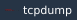
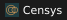
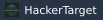
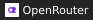
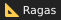
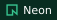

# whoami

<picture>
  <source media="(prefers-reduced-motion: reduce)" srcset="assets/profile/cyber-lab-transparent-still-v2.png">
  
</picture>

**Cybersecurity, software development & automation.**

I’m a French developer working across cybersecurity, threat intelligence and automation. I build tools that support investigations, connect workflows and make data easier to use.

An école 2600 alumnus, I hold qualifications in Systems, Network and Data Security (RNCP Level 7) and Web Development (RNCP Level 5).

Here you’ll find open-source projects, ethical hacking experiments, AI assistants — and the occasional cocktail app. 🍸

 

## 🧰 Stack

**Cybersecurity / Ethical Hacking** — web and network security, CTFs, risk analysis (EBIOS RM), and security assessment workflow automation.

    

              

**CTI / Threat Intelligence**

      

                            

**AI / LLM / RAG**

        

       

**Languages & Infrastructure / DevOps**

    

## 🧳 Projects

- **[bikefinder-rag](https://github.com/maax6/bikefinder-rag)** — Local RAG combining SQL and vector search (BGE-M3, pgvector, Mistral via Ollama) across 11,478 technical records, with [public benchmarks](https://maax6.github.io/bikefinder-rag/benchmark.html) comparing eight models.
- **[EBIOS-RM-Calculator](https://github.com/maax6/EBIOS-RM-Calculator)** — Likelihood assessment for EBIOS RM workshop 4 (ANSSI), with JSON/PDF export.
- **[cidr-subnet-calculator](https://github.com/maax6/cidr-subnet-calculator)** — Interactive IPv4/IPv6 subnet calculator and learning tool, available in six languages.
- **[droit-vivant](https://github.com/maax6/droit-vivant)** — Monitoring digital, cybersecurity and AI law across France, the EU and the ECHR, alongside broader reading.

## 🤝 Contributions
- **Silent lab ...**
- **[Iskandeur/bounce-cti#56](https://github.com/Iskandeur/bounce-cti/pull/56)** — STIX 2.1 export conformance.

## 📊 GitHub

  
  

  
  

### ✍️ Developer quote

